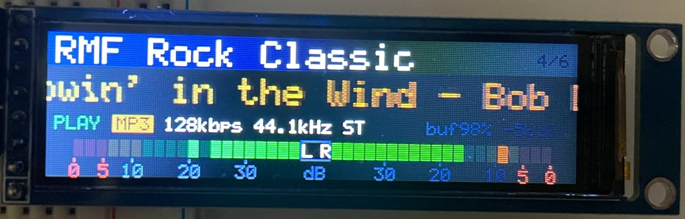
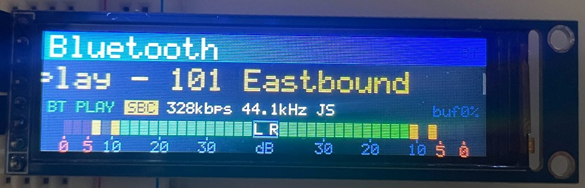
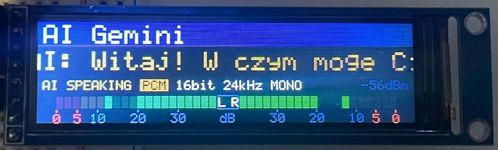
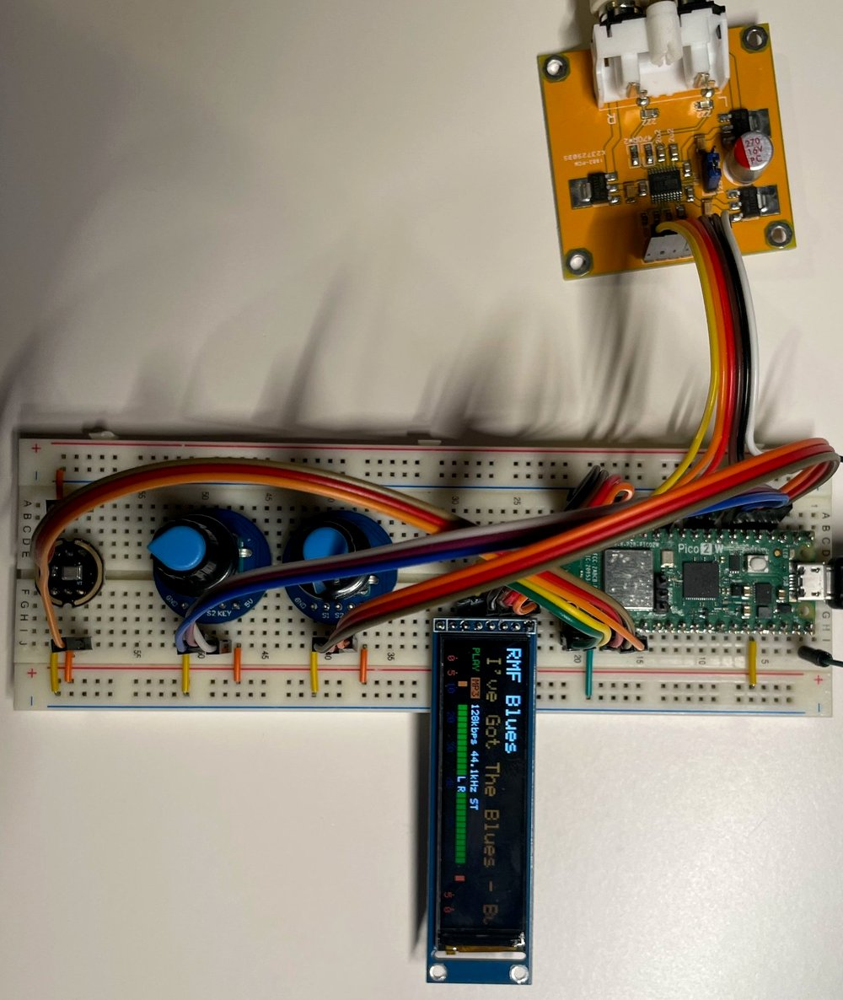
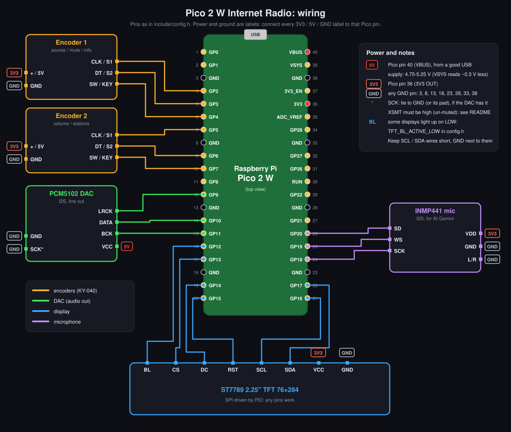
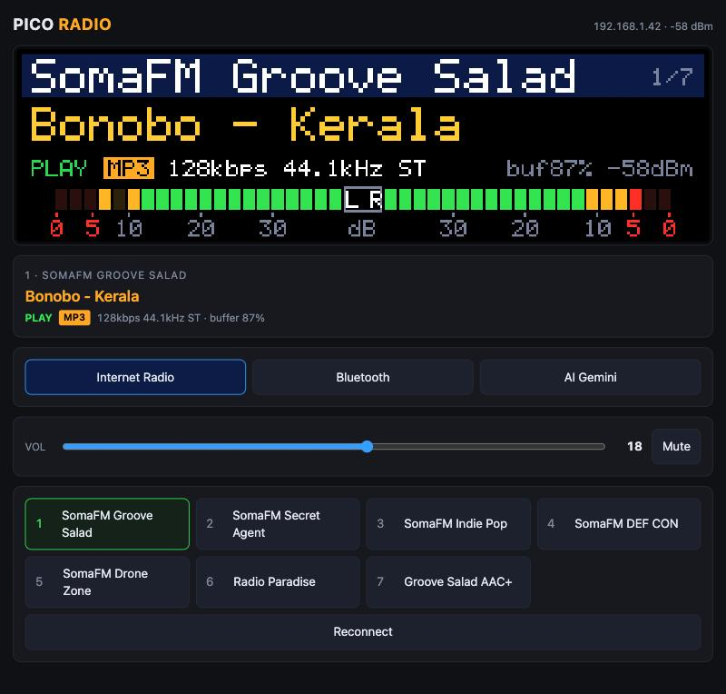
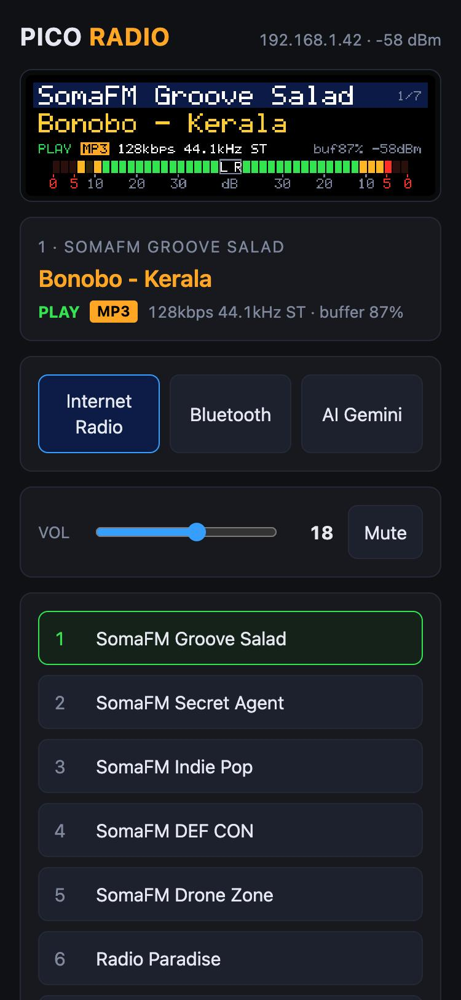
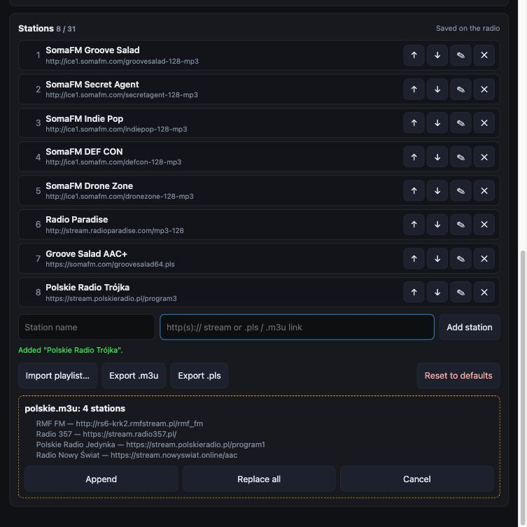
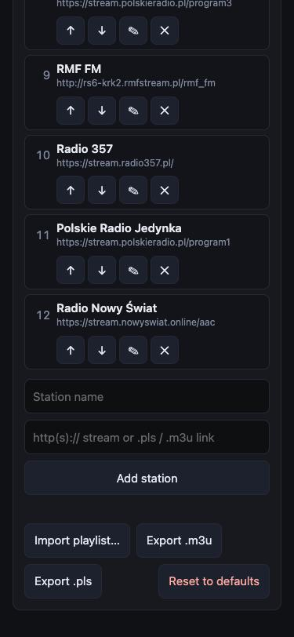

<p align="center">
  <picture>
    <source media="(prefers-color-scheme: dark)" srcset="docs/logo/logo.svg">
    
  </picture>
</p>
<p align="center"><a href="https://www.paypal.com/donate/?business=smulewsk%40gmail.com&no_recurring=0&item_name=Pico+Radio"></a></p>

# Pico 2 W Internet Radio (FreeRTOS)

Pico Radio turns a Raspberry Pi Pico 2 W and a handful of cheap modules into a complete desktop radio. It plays internet radio stations, works as a Bluetooth speaker for your phone, and has a voice assistant you can talk to. Two knobs and a small colour display handle everyday use. A web page on your phone or computer does the rest: pick stations, edit the list, change settings and update the firmware.

**Three sources, one radio:**
- **Internet radio:** MP3 and AAC/AAC+ streams over HTTP and HTTPS, with song titles from the stream. Up to 31 stations of your own, with playlist import and export.
- **Bluetooth:** pair your phone and play its music through the radio, with artist, title and play/pause/next on the knobs.
- **AI assistant:** switch to *AI Gemini*, ask a question out loud, and hear the answer through the speaker. It uses Google's Gemini Live API on the free tier, in English or another language you choose.

**Hardware:** a Pico 2 W, a PCM5102 I2S DAC for line-level audio, a 2.25" ST7789 display (284×76), two rotary encoder modules (KY-040, or the ones labelled S1 / S2 / KEY) and, for the AI, an INMP441 microphone. Everything runs on 5 V from USB. Each module connects with a few jumper wires; see [Wiring](#wiring).

**Everyday use:**
- **Remembers you:** the radio starts on the last station at the last volume.
- **Web setup:** WiFi, names, the Gemini key and voice are set from the web page, with no rebuilding.
- **Safe updates:** firmware updates go over WiFi into a spare flash slot. If a new version fails to start, the radio falls back to the previous one.

## Screenshots

**Internet radio:** station, song title from the stream, codec, bitrate and a stereo VU meter.


**Bluetooth:** your phone's music, with artist and title.


**AI Gemini:** the spoken answer also scrolls on the display.


<p align="center"></p>
<p align="center"><em>The prototype on a breadboard: Pico 2 W, PCM5102 DAC with RCA outputs, two encoders, the INMP441 microphone and the display.</em></p>

## Under the hood

The firmware is written in C on FreeRTOS, using both cores of the RP2350. It was built for the Pico 2 W:

- **FreeRTOS SMP** on both cores
- **lwIP sockets** over WiFi, **HTTP and HTTPS** + Shoutcast/Icecast **ICY metadata** (song titles), redirects, **.pls / .m3u playlist links**
- **MP3 decoding** with [minimp3](https://github.com/lieff/minimp3) (32–320 kbps, mono or stereo, any sample rate)
- **AAC and HE-AAC (AAC+) decoding** with the Helix AAC decoder, for `audio/aac` and `audio/aacp` streams (ADTS)
- **PCM5102** I2S DAC driven by PIO + DMA
- **ST7789 2.25" 76×284** TFT (landscape 284×76), DMA framebuffer, SPI through PIO (any pins)
- **2 rotary encoders**: volume and station
- **Web remote**: control page at **http://picoradio.local** with a live copy of the display, a station editor and a **settings page** (WiFi, Gemini key, names... no rebuild needed)
- **WiFi setup network**: without a working WiFi the radio opens its own network (`picoradio`), and a phone that joins it lands on the settings page
- **Firmware updates over WiFi** from the web page, with automatic fallback to the previous firmware
- **Remembers** the last station and volume across power-off
- **AI voice assistant**: talk to Google Gemini through an **INMP441** microphone and hear the spoken answer on the radio (Gemini Live API, free tier). English by default, or any other language set on the web page; it greets you when you switch to it
- **Bluetooth audio (A2DP sink)**: stream from your phone. AVRCP shows the artist and title, encoder 2 controls play/pause and next track, and volume stays in sync with the phone

| Core | Task | Job |
|---|---|---|
| 0 | `net` | WiFi, HTTP/HTTPS, playlists, ICY demux → 48 KB stream buffer |
| 0 | `ui` | encoders, screen at 25 fps, saves station / volume |
| 0 | `web` | HTTP server (port 80) for the web remote, settings and firmware updates, mDNS `picoradio.local` |
| 0 | `rssi` | reads the WiFi signal strength every 3 s (lowest priority, so it never holds up the screen) |
| 1 | `dec` | MP3 / AAC → PCM (radio) or PCM passthrough (Bluetooth, AI), volume, VU levels, 6×1152-frame I2S buffers (DMA IRQ) |
| any | CYW43 / BTstack | WiFi driver, Bluetooth stack, SBC decoding |

In AI mode the `net` task also runs the microphone and the secure WebSocket (mbedTLS) connection to Gemini.

## Wiring



The diagram shows the Pico from the top, USB up, with its real pin order. Power and ground are drawn as labels: connect every **3V3** label to pin 36, **5V** to pin 40 (VBUS) and **GND** to any GND pin. `docs/make_wiring.py` redraws it if you change pins.

| Module pin | Pico 2 W | Physical pin |
|---|---|---|
| **PCM5102 DAC** | | |
| BCK | GP11 | 15 |
| DATA (DIN) | GP10 | 14 |
| LRCK (LCK) | GP9 | 12 |
| GND | GND | 13 (next to GP9) |
| SCK, if the board has it | GND | any GND (or bridge its SCK pad) |
| VCC / VIN | VBUS (5 V) | 40 |
| **ST7789 2.25" TFT** | | |
| BL / BLK (backlight) | GP12 | 16 |
| CS | GP13 | 17 |
| DC | GP14 | 19 |
| RST / RES | GP15 | 20 |
| SCL / SCK | GP16 | 21 |
| SDA / MOSI | GP17 | 22 |
| VCC | 3V3 | 36 |
| GND | GND | 18 or 23 |
| **INMP441 microphone** | | |
| SCK | GP18 | 24 |
| WS | GP19 | 25 |
| SD | GP20 | 26 |
| L/R (selects the left channel) | GND | any GND |
| VDD | 3V3 | 36 |
| GND | GND | 23 or 28 |
| **Encoder 1: source** | | |
| CLK (A) / S1, DT (B) / S2, SW / KEY | GP2, GP3, GP4 | 4, 5, 6 |
| **Encoder 2: volume + stations** | | |
| CLK (A) / S1, DT (B) / S2, SW / KEY | GP5, GP6, GP7 | 7, 9, 10 |
| **Both encoders** | | |
| + / VCC / 5V | **3V3** (even if the pin says 5V; required) | 36 |
| GND | GND | 3 or 8 |

Tips:
- **Power:** use a decent USB charger and cable. VBUS (pin 40) should read 4.75–5.25 V; a weak supply (below ~4.5 V) gives noise in the audio. Powering the DAC from 5 V lets its own regulator make a clean 3.3 V.
- **Display wires:** keep SCL and SDA short (under ~10 cm) with a GND wire next to them. Long loose wires at 37.5 MHz can corrupt the picture; then lower `TFT_SPI_HZ`.
- **Display backlight:** some modules light up when BL is *low*: set `TFT_BL_ACTIVE_LOW 1` (the default here) or 0 for modules that light up on high. If the backlight comes on at power-on and then fades out, this is the setting to flip.
- **Encoders:** modules are labelled either CLK / DT / SW or S1 / S2 / KEY: same thing.
  - **Power:** the + pin **must** go to 3V3 (not 5V). S1 / S2 are read as plain inputs (`ENC_AB_PULLUP 0`) and rely on the module's own pull-up resistors, which hang off that pin; the Pico's inputs aren't meant for 5 V. If + is left open, S1 / S2 sit at a half level and turning does nothing.
  - **Missing pull-up on a module:** if one line stays at 0 (a resistor missing or broken), solder 10 kΩ from that pin to +, or set `ENC_AB_PULLUP 1` to add the Pico's internal pull-ups (fine once + is on 3V3).
  - **Direction:** `ENC1_REVERSE` / `ENC2_REVERSE` (both 1 here, which suits these modules). Backwards → flip the setting or swap S1 and S2.
  - **Steps:** one click moves two steps (or two clicks one step) → `ENC_STEPS_PER_DETENT` 2 instead of 4.
  - The encoders are sampled 2000 times a second (not on interrupts), so a bad contact can't stall the radio.
- **Display colours:** inverted colours (yellow shows as blue, green as purple) → toggle `TFT_INVERT`. Red and blue swapped → toggle `TFT_BGR`.

**PCM5102 module jumpers.** Small boards with only BCK / DATA / LRCK / GND / VCC pins have these set already, so skip this. On boards with pads on the back (GY-PCM5102), solder them like this, or you get no sound:

| Jumper | Setting |
|---|---|
| H1L (FLT) | **L** |
| H2L (DEMP) | **L** |
| H3L (XSMT) | **H** (un-mute) |
| H4L (FMT) | **L** (I2S) |

Also bridge the SCK pad on the front to GND, or wire SCK to GND.

You can change any pin in `include/config.h`. The three DAC pins and the six display pins can be any GPIOs, in any order: both are driven by PIO programs (`src/i2s.pio`, `src/tft_spi.pio`), not the SPI/I2S hardware blocks. The mic's WS must stay at SCK + 1.

## Configure

Most settings are changed on the radio's web page (**Settings** card, see [Settings page](#settings-page)) and kept in flash. `include/config.h` holds the hardware setup and the **factory defaults** for those settings:

- **Factory defaults** (all changeable later on the web page): `WIFI_SSID` / `WIFI_PASSWORD`, `WEB_HOSTNAME`, `BT_DEVICE_NAME`, `RADIO_TLS_VERIFY`, `GEMINI_API_KEY` (free at <https://aistudio.google.com/apikey>), `GEMINI_MODEL`, `GEMINI_VOICE`, `AI_LANGUAGE` (`"English"`, any other language name, or `"auto"`), `AI_GREETING`, `AI_SYSTEM_PROMPT`.
- **WiFi for the first start:** put your network in `WIFI_SSID` / `WIFI_PASSWORD` (or pass them to CMake, below). Or leave them as they are: the radio then opens its [setup network](#wifi-setup-access-point) and you enter the WiFi on the page.
- **Setup network:** `AP_SSID`, `AP_PASSWORD` (8+ characters, `""` = open), `AP_AFTER_FAILS`, `AP_IDLE_MIN`.
- `STATIONS[]`: the **factory** station list (edit stations later on the web page). Each entry is a name and URL. A URL can be:
  - an `http://` or `https://` MP3, AAC or AAC+ stream, or
  - a link to a `.pls` or `.m3u` playlist (what many station websites offer). The radio plays the first stream in it.

  Ogg/Opus, FLAC, MP4/LATM and HLS (`.m3u8`) streams are not supported, and the screen says so when it hits one.
- **Pins:** `PIN_*`. See [Wiring](#wiring).
- **Display:** the offsets, `TFT_MADCTL` (0x60, or 0xA0 to flip it 180°), `TFT_BGR`, `TFT_INVERT`, `TFT_BL_ACTIVE_LOW`, `TFT_SPI_HZ`.
- **Encoders:** `ENC_STEPS_PER_DETENT` (try 2 if one click moves two steps), `ENC1_REVERSE` / `ENC2_REVERSE`, `ENC_AB_PULLUP` (Pico pull-ups on S1 / S2; 0 = the module's own). See the encoder tips under [Wiring](#wiring).
- **Audio:** `VOLUME_DEFAULT`, the level trims `TRIM_RADIO_DB` / `TRIM_BT_DB` / `TRIM_AI_DB` (see [Notes](#notes-and-ideas)), `MIC_GAIN`.
- **Bluetooth:** `BT_SECURE_CONNECTIONS` (see [Bluetooth](#bluetooth)).

## Build

You need the Pico SDK 2.x and the ARM toolchain. The VS Code Pico extension installs both in `~/.pico-sdk`.

```bash
git clone https://github.com/<your-account>/picoradio.git
cd picoradio
./setup.sh          # fetches FreeRTOS, minimp3 and Helix AAC into lib/
```

```bash
cmake -S . -B build -G Ninja -DPICO_TOOLCHAIN_PATH=$HOME/.pico-sdk/toolchain/14_2_Rel1
```

```bash
cmake --build build
```

You can also pass the factory WiFi and API key at build time instead of writing them into `config.h`:

```bash
cmake -S . -B build -G Ninja -DWIFI_SSID="MyWiFi" -DWIFI_PASSWORD="secret" -DGEMINI_API_KEY="AIza..."
```

The build makes `build/pico_radio.uf2` (the firmware) and `build/pt.uf2` (the flash partition table, needed once).

To flash: hold BOOTSEL, plug in the USB cable, and copy `build/pico_radio.uf2` onto the RP2350 drive. Debug output goes to the USB serial port (the Pico shows up as a serial device, e.g. `/dev/tty.usbmodem…` on a Mac; any baud rate). It reconnects after each restart, so reopen the serial monitor if it goes quiet.

**First time only (for updates over WiFi):** before `pico_radio.uf2`, copy `build/pt.uf2` onto the RP2350 drive. It writes the partition table with the two firmware slots (see [Firmware updates over WiFi](#firmware-updates-over-wifi-ota)). The radio then comes back as the RP2350 drive (if not, enter BOOTSEL again), and you copy `pico_radio.uf2` as usual. Your stations and the Bluetooth pairing stay. After that you can update from the web page.

If `PICO_SDK_PATH` isn't set, the build uses `~/.pico-sdk/sdk/2.3.0` (the VS Code extension's copy). Without any SDK installed, configure with `-DPICO_SDK_FETCH_FROM_GIT=on` (and `-DPICO_SDK_FETCH_FROM_GIT_TAG=2.3.0`) and CMake downloads it.

**VS Code tasks** (*Terminal → Run Task…*, or ⇧⌘B for *Compile Project*):

| Task | Does |
|---|---|
| Compile Project | `ninja -C build` |
| Compile & OTA Flash | build, then send `pico_radio.uf2` to the radio over WiFi |
| OTA Flash (curl) | only the WiFi upload ([OTA](#firmware-updates-over-wifi-ota)) |
| Compile & Flash (USB) | build, then load over USB with picotool |
| Run Project | load over USB with picotool |

The OTA tasks ask for the radio's address (Enter = `picoradio.local`; use the IP if `.local` doesn't resolve, or `192.168.4.1` in [setup mode](#wifi-setup-access-point)). To give a task its own shortcut, add it to your keyboard shortcuts (⇧⌘P → *Preferences: Open Keyboard Shortcuts (JSON)*):

```json
{ "key": "cmd+alt+u", "command": "workbench.action.tasks.runTask", "args": "Compile & OTA Flash" }
```


## Controls

**Encoder 1 picks the source.** Turn it to open the picker (*Internet Radio* / *Bluetooth* / *AI Gemini*), then push to switch. When the picker is closed, a push mutes.

**Encoder 2 sets volume and picks stations.** Turning it always changes the volume, unless the station list is open.

| | Turn | Push | Long push (0.7 s) |
|---|---|---|---|
| Encoder 1 | Open the source picker / move in it | Switch to the picked source (picker closed: mute on/off) | Info screen (IP, RSSI, heap, underruns) |
| Encoder 2 (radio) | Volume (moves in the list while it is open) | Open the station list / tune to the highlighted station | Reconnect |
| Encoder 2 (Bluetooth) | Volume (synced with the phone) | Play / pause | Next track |
| Encoder 2 (AI) | Volume | Microphone on / off | Start a new conversation |

**Holding encoder 1 pressed while switching on** starts the radio with the factory settings from `config.h` (for when a wrong WiFi password locks you out). **Holding encoder 2** while switching on, or pressing it in the first 2 seconds while the logo shows, opens the [setup network](#wifi-setup-access-point) instead.

Lists close by themselves after 6 seconds without input. A `*` marks what is playing now. Switching from Bluetooth back to *Internet Radio* returns to the last station you listened to.

## Bluetooth

1. Turn encoder 1 to **Bluetooth** and push. The header turns blue and the screen shows *BT WAITING FOR PHONE*.
2. On the phone, open Bluetooth settings and pair with **Pico Radio** (change the name on the web page under Settings). There is no PIN: the radio accepts the pairing by itself.
3. Play music on the phone. The screen shows the artist and title.

The pairing is saved in flash. Next time you pick Bluetooth, the radio tries to reconnect to the last phone by itself.

When you switch back to *Internet Radio* with encoder 1, the radio disconnects the phone, hides itself from Bluetooth, and goes back to WiFi streaming. Bluetooth is only visible while the Bluetooth source is selected.

Pairing problems:
- **"Pairing failed" on the phone (status `0x05` in the log):** in the web page's Bluetooth panel press **Forget paired phones**, on the phone choose *Forget this device* and switch Bluetooth off and on, then pair again.
- `BT_SECURE_CONNECTIONS` (config.h) allows the newer "Secure Connections" pairing. It's on here; set it to 0 if a phone fails to pair.

Notes:
- Only the SBC codec is supported. Every phone supports it, and A2DP always falls back to it.
- The phone's clock and the Pico's audio clock drift apart a little. The decoder keeps about 0.1–0.25 s of audio buffered and drops a few samples when the buffer gets too full. You shouldn't hear it.
- WiFi stays connected in Bluetooth mode, so switching back to a station is fast.

## AI voice assistant (Gemini)

1. Get a free Gemini API key at <https://aistudio.google.com/apikey> and enter it on the web page (**Settings → AI Gemini → API key**). No rebuild needed.
2. Turn encoder 1 to **AI Gemini** and push. The header turns purple. After about a second Gemini greets you (switch this off under Settings → Greeting) and the screen shows **AI LISTENING** with a microphone level meter.
3. Just talk, in the language set under Settings (English by default), e.g. *"What is the capital of Australia?"*. When you stop, Gemini answers out loud. The screen shows what you said (`You: ...`) and then the answer (`AI: ...`).
4. Keep talking. It remembers the conversation until you leave AI mode or long-press encoder 2.

How it works:
- The INMP441 is read at 32 kHz by a PIO program and filtered down to 16 kHz.
- 100 ms audio chunks go over a secure WebSocket (TLS, verified against Google's root certificates) to the Gemini Live API, model `gemini-3.8-live` (changeable under Settings).
- **Language and voice:** set under Settings. The radio adds "Always answer in <language>" to the instructions, or "answer in the language the user speaks" for *Automatic*. There are 30 voices (Kore, Puck, Charon, ...); the field suggests them.
- Gemini detects when you have finished speaking, then streams its voice back as 24 kHz PCM. That audio plays through the same output and volume control as the radio.
- **Half-duplex:** the microphone is muted while the answer plays, so the radio doesn't hear itself. You can't interrupt an answer; wait for *AI LISTENING*.
- Push encoder 2 to turn the microphone off (*AI MIC OFF*), for example while people are talking nearby.
- Gemini ends sessions after about 15 minutes. The radio reconnects by itself, and that starts a new conversation.

**Controlling the radio by voice.** Gemini can work the radio for you through function calls:

| Say, for example | What happens |
|---|---|
| "Play RMF FM", "put on some jazz", "play a Polish news station" | `play_station`: looks in your saved stations first, then searches **radio-browser.info** (a free directory of ~50,000 stations). Gemini says what it found in one sentence, then the radio switches to it and AI mode ends. |
| "Save this station", "add Radio Nowy Świat to my stations" | `add_station`: saves the station just played (or searches for one) to your list. |
| "Remove RMF Classic from my stations" | `remove_station` |
| "What stations do I have?" | `list_saved_stations` |
| "Turn it down to 30 percent" | `set_volume` |

- A station found in the directory plays without being added to your list: the screen shows `NEW` instead of the station number, and the web page says *Found by AI*. Say "save it" (in AI mode) to keep it.
- Only stations the radio can play are picked: MP3 or AAC/AAC+ over HTTP(S), not HLS or Ogg. The most popular match wins; Gemini mentions a few others.
- The directory is searched over plain HTTP (the radio's single TLS connection is busy with Gemini), from the `de1`, `nl1` or `at1.api.radio-browser.info` mirrors. Only the search words go there.
- The serial log shows every call: `[ai] function play_station(...)` and its result.

Notes:
- **Privacy:** while *AI LISTENING* is shown, everything the microphone hears is sent to Google. On the free tier, Google may use the data to improve its products. Switch to another source, or push encoder 2, to stop listening.
- If the meter barely moves when you speak, raise `MIC_GAIN` (default 16 = +24 dB). If it is often red, lower it.
- The free tier has rate limits. If you hit them, the screen shows a connection error and the radio retries every few seconds.

## Web remote

Open **http://picoradio.local** on a phone or computer on the same WiFi. If your device doesn't support `.local` names (some Android phones), use the IP address shown on the info screen (long-press encoder 1).

 

What the page shows and does:
- **Live display:** a pixel-exact copy of the TFT, up to ~15 frames per second (compressed, and skipped when nothing changed).
- **Now playing:** station, song title with proper Polish letters (the TFT itself uses plain ASCII), and the stream parameters.
- **Source:** Internet Radio, Bluetooth or AI Gemini.
- **Volume and Mute:** synced with the knobs and, in Bluetooth mode, with the phone.
- **Radio:** a station list and Reconnect. **Bluetooth:** Previous, Play/Pause and Next. **AI:** microphone on/off, a new conversation, and the mic level.
- **Edit stations:** add, rename, change the URL, reorder (↑ ↓) and delete. Changes are saved on the radio and survive power-off.
- **Import and export:** import an `.m3u`, `.m3u8` or `.pls` playlist (you see a preview, then choose *Append* or *Replace all*), or export the list as `.m3u` / `.pls`.
- **Settings:** WiFi, names, the Gemini key, voice, language and more. See [Settings page](#settings-page).
- **Firmware:** the version, build time and slot, and updates over WiFi. See [Firmware updates](#firmware-updates-over-wifi-ota).

### Stations

**The last station and the volume are remembered** across power-off. They're saved 5 s after you stop changing them, so browsing or turning the knob doesn't wear out the flash. They're kept in their own flash sector (below the stations, outside the firmware slots), so OTA updates keep them too. Mute isn't saved, and Bluetooth / AI mode always start back on the radio.

 

- **Storage:** up to 31 stations, kept in flash. Names can be up to 47 bytes (Polish letters fine; the TFT shows them without accents), URLs up to 207 characters.
- **Factory list:** the stations in `config.h`. They are used until you first edit the list. *Reset to defaults* brings them back.
- **Power cuts:** each save writes the whole list to the second of two flash slots and only then switches to it, so a power cut during a save keeps the previous list.
- **Saving pauses the music:** a flash write briefly stops both processor cores, so playback pauses for about 0.1 s.
- **Import:** reads names and URLs from `#EXTINF` (M3U) or `File`/`Title` (PLS) lines. Entries that aren't `http(s)` are skipped. HLS entries are imported, but say "not supported" when played.
- **Export:** `http://picoradio.local/stations.m3u` also opens directly in VLC, so the same list plays on your computer.
- **Playing station:** if you delete or move the station that's playing, it keeps playing under its new position. Changing its URL reconnects it.

The page lives in `web/index.html` and is built into the firmware, gzip-compressed; CMake regenerates `web_page.h` when you edit it. The radio's name (`picoradio`) is set under Settings.

API, for scripts or Home Assistant. `/api/cmd` and every POST need the header `X-Pico-Radio: 1`, e.g. `curl -H "X-Pico-Radio: 1" "http://picoradio.local/api/cmd?a=vol&v=20"`:

| Request | Effect |
|---|---|
| `GET /api/status` | JSON: source, station, title, state, codec, kbps, rate, volume, mute, buffer, RSSI, VU levels, mic level, firmware version / build time / slot |
| `GET /api/screen.bmp` | the current display as a 284×76 BMP |
| `GET /api/screen.rle?h=..` | the display run-length coded, as the page uses it (a few KB); `204` if it hasn't changed since the frame with hash `h`. Format in `src/web.c` |
| `GET /api/cmd?a=tune&v=3` | play station 4 (0-based) |
| `GET /api/cmd?a=source&v=radio\|bt\|ai` | switch source |
| `GET /api/cmd?a=vol&v=20` | set volume (0–32) |
| `GET /api/cmd?a=mute` / `play` / `next` / `prev` / `mic` / `reload` | toggle mute, Bluetooth playback, AI mic, reconnect or new conversation |
| `GET /api/cmd?a=btforget` | delete all paired phones (also the "Forget paired phones" button in Bluetooth mode) |
| `GET /api/cmd?a=restart` | restart the radio |
| `GET /api/config`, `POST /api/config` | read / save the settings (see [Settings page](#settings-page)) |
| `GET /api/stations` | JSON: `{"max":31,"default":false,"list":[{"name":..,"url":..}]}` |
| `POST /api/stations` (form) | `a=add&name=..&url=..`, `a=edit&i=..&name=..&url=..`, `a=del&i=..`, `a=up&i=..`, `a=down&i=..`, `a=reset`, `a=import&mode=append\|replace&data=<name TAB url per line>` |
| `GET /stations.m3u`, `GET /stations.pls` | the station list as a playlist |
| `POST /api/ota` (raw body) | firmware update with `build/pico_radio.uf2` or `.bin`; the radio restarts on it. Reply: `{"ok":true,"slot":"B"}` or `{"ok":false,"error":".."}` |

There is no password: anyone on your WiFi can control the radio, and update its firmware. Keep it on a home network you trust. Other web sites open in your browser can't: everything that changes something (uploads, settings, station edits, `/api/cmd`) must carry the header `X-Pico-Radio: 1`, which only the radio's own page, the VS Code tasks and your own scripts send. Add `-H "X-Pico-Radio: 1"` when you use `curl`.

## Settings page

The **Settings** card on the web page changes, without rebuilding:

| Group | Settings |
|---|---|
| WiFi | network name, password, the radio's name (`http://<name>.local`) |
| Bluetooth | the name the phone sees |
| AI Gemini | API key, model, voice (list of the 30 voices), answer language (or automatic), greeting on/off, instructions (system prompt) |
| Stations | check HTTPS certificates |

- **Saving:** settings are kept in flash, outside the firmware slots, so OTA updates keep them. Two copies are written alternately, so a power cut while saving keeps the previous settings.
- **When changes apply:** Gemini settings apply at the next AI conversation (right away if AI is playing). WiFi and the names apply after a restart; the page offers a *Restart now* button.
- **Secrets:** the WiFi password and the API key are never sent back to the page, which only shows whether they are set. Leave the field empty to keep the saved one.
- **Defaults:** the values in `include/config.h` are the factory defaults. *Factory settings* goes back to them.
- **Locked out?** If the radio can't join WiFi any more (a typo in the password, a new router), it opens the [setup network](#wifi-setup-access-point) after 3 failed tries, or right away when **encoder 2** is held while switching on. Holding **encoder 1** instead starts with the `config.h` settings and erases the saved ones.
- **Open network / removing the key:** tick *Open network (no password)* for a WiFi without a password, or *Remove the saved key* to delete the Gemini key.
- **API:** `GET /api/config`, `POST /api/config` (form fields `ssid pass clearpass hostname btname key clearkey model voice lang greet prompt tls`, or `a=reset`), `GET /api/cmd?a=restart`. POSTs and `/api/cmd` need the `X-Pico-Radio: 1` header.

Pins and display options stay in `config.h`: they need different wiring anyway.

### WiFi setup (access point)

When the radio has no WiFi to join, it opens its own network so you can set it up from a phone:

1. **When it opens:** no WiFi set yet (the `config.h` placeholder), the network can't be joined 3 times in a row after power-on (`AP_AFTER_FAILS`), or **encoder 2 held** while switching on (pressing it within the first 2 seconds, while the logo shows, works too). The screen shows **WIFI SETUP** and *Join WiFi picoradio, open 192.168.4.1*.
2. **Join it:** network `picoradio`, no password (`AP_SSID` / `AP_PASSWORD`). Most phones then open the radio's page by themselves; otherwise go to <http://192.168.4.1>.
3. **Enter your WiFi** in the Settings card (it opens by itself) and press **Save**. The radio restarts and joins your network, and the page is at `http://picoradio.local` again.

- **Open network:** without a password anyone nearby can join while it's open and change the settings. Set `AP_PASSWORD` (8+ characters) if that matters.
- **Bluetooth** still works while the setup network is open; internet radio and AI need your WiFi.
- **A WiFi that worked before** (router restarting) is retried forever and never opens the setup network. If the setup network was opened by failures and nobody joins it within 10 minutes (`AP_IDLE_MIN`), the radio restarts and tries your WiFi again.

## Firmware updates over WiFi (OTA)

**Version.** The firmware version is set in `CMakeLists.txt`: `project(pico_radio VERSION 1.0.0 ...)`. Bump it when you release a change. Every build also records its build time. Both show on the Firmware card and at the bottom of the web page, in the top line of the info screen (long-press encoder 1), in the serial log at boot, and in `picotool info`. `GET /api/status` has them as `ver` and `built`.

The web page has a **Firmware** card: pick `build/pico_radio.uf2` (a `.bin` works too) and the radio writes it into its spare flash slot, then restarts on it. The display shows the progress. The internet stream (and the AI) pause meanwhile, so the upload gets the whole WiFi link; Bluetooth keeps playing, muted. If the update fails, the stream resumes. The page waits for the radio to come back and tells you which slot it runs from.

From the command line:

```bash
curl --data-binary @build/pico_radio.uf2 -H "Content-Type: application/octet-stream" -H "X-Pico-Radio: 1" http://picoradio.local/api/ota
```

In VS Code, the *Compile & OTA Flash* task does the build and this upload in one go (see [Build](#build)).

How it works. It uses the RP2350 boot ROM's own A/B partitions, so there's no extra bootloader:

- **Two slots.** `pt.json` splits the flash into slot A and slot B of 1984 KB each (the firmware is about 830 KB). The last 120 KB stay outside the slots, for the settings, the stations, the last station / volume and the Bluetooth pairing, so updates don't touch them.
- **Safe writing.** The update goes into the slot that isn't running. Its first sector is erased first and written last, so a slot never holds half a firmware that could boot. A broken upload (WiFi drop, wrong or cut-off file, UF2 for another chip) is refused and the radio keeps running as before.
- **Try before you buy.** The new firmware is marked "TBYB" while it's written, and the radio restarts with a flash-update boot, which lets the boot ROM run it once. It confirms itself once the web server is up (or after 12 s without WiFi), and only then is it kept. If it crashes or hangs before that, switch the radio off and on: the boot ROM starts the previous firmware again.
- **After the confirm** the old slot is wiped, so normal boots always pick the new firmware. The next update goes there.
- **Size check.** The build fails if the firmware outgrows a slot. Change both sizes in `pt.json` if you ever need more (and flash `pt.uf2` again).

Things to know:
- **Without the partition table** (an old install, or flashed over SWD) the radio works normally, but the Firmware card says updates need `pt.uf2`. The info screen and the web page show the slot (`FW slot A` / `B`, or `-` without a partition table).
- **Flashing over USB still works.** Copying `pico_radio.uf2` onto the BOOTSEL drive puts it into a slot too, and it's kept the same way.
- **SWD (the VS Code "Flash" task / OpenOCD)** writes the `.elf` at the start of flash and overwrites the partition table. Copy `pt.uf2` and `pico_radio.uf2` again over USB afterwards.
- **There's no signature check:** the radio accepts any RP2350 Arm firmware from your network.

More screenshots are in `docs/screenshots/web/`. They were taken in a browser on a computer, with a stand-in for the radio that serves the same page and API and display frames drawn by the radio's own display code.

## Troubleshooting

| Symptom | Check |
|---|---|
| Screen shows PLAYING, VU moves, but no sound | DAC wiring (BCK GP11, DATA GP10, LRCK GP9). On the DAC: SCK pad to GND, XSMT high (un-muted). Volume not at 0, not muted. |
| Hiss, buzz or crackle | VBUS below ~4.5 V: better charger / cable. DAC on 5 V (VBUS). Short wires, GND next to the signal wires. Mute test: noise while muted = electrical; only while playing = the stream (watch the underrun counter on the info screen). |
| Backlight on at power-on, then fades to dark | `TFT_BL_ACTIVE_LOW` the wrong way round for your module. |
| Wrong colours on the display | `TFT_INVERT` (inverted colours) or `TFT_BGR` (red/blue swapped). |
| Garbage or shifted lines on the display | Long display wires: shorten them or lower `TFT_SPI_HZ`. |
| First WiFi attempt fails, second works | Normal now and then; the radio retries by itself. The log says why (`timeout`, `wrong password`, ...). |
| Can't reach the radio after changing WiFi | It opens the `picoradio` network after 3 failed joins (or hold encoder 2 while switching on): join it and fix the WiFi. Holding encoder 1 goes back to the `config.h` settings. |
| Encoder push works, turning does nothing | The module's + pin isn't on 3V3. With + connected, one line stuck at 0 means a missing pull-up on the module: 10 kΩ from it to +, or `ENC_AB_PULLUP 1`. |
| Encoder turns the wrong way | `ENC1_REVERSE` / `ENC2_REVERSE`. |
| Phone won't pair (`status 0x05`) | *Forget paired phones* on the web page, forget the radio on the phone, pair again. See [Bluetooth](#bluetooth). |
| `TLS handshake failed` on an https station | The log shows the reason. Try the station's `http://` address, or untick *Check station certificates* if it's an unknown CA. |
| AI says "Set the Gemini API key" | Enter the key under Settings → AI Gemini. |
| Update fails / is slow | The log shows `[ota]` lines. Updates need `pt.uf2` flashed once over USB. |

## HTTPS stations

HTTPS works for radio streams, playlists and redirects.

- **Certificates:** checked against 23 bundled root certificates from the Mozilla trust store (`src/ca_roots.h`): Let's Encrypt, DigiCert, Sectigo/USERTrust, GlobalSign, Google, Amazon, Microsoft, GoDaddy/Starfield and the Polish CA Certum. Roots stay in flash and are parsed only when a server's chain names them, so the bundle costs 21 KB of flash and almost no RAM.
- **Tested from a computer** with this exact TLS code: SomaFM (playlist and AAC stream), Radio Paradise, Polskie Radio, RMF FM, Google, GitHub, DigiCert, Certum, Microsoft and Cloudflare all verify.
- **"TLS: unknown cert authority":** the station uses a CA that isn't bundled. Untick *Check station certificates* under Settings (or `RADIO_TLS_VERIFY 0`) to skip the check for radio streams; the audio is still encrypted. The Gemini connection always verifies, because it carries your API key.
- **Office networks:** a network with an HTTPS-inspecting firewall replaces the certificates, and verification fails. That is the check doing its job.
- **Memory:** a TLS connection needs about 47 KB while connecting and 28 KB while streaming. With AAC+ over HTTPS, TLS plus the AAC decoder need about 110 KB at once. That fits only because `src/mem.c` spreads big blocks over both heaps (FreeRTOS pool and C heap) with best-fit placement. The info screen (long-press encoder 1) shows both: `Free RTOS ..K  C ..K`.
- **Not checked:** certificate dates (the radio has no clock), and revocation.

## Screen (284×76)

```
| Station name                               3/6 |  <- header (blue / BT blue / AI purple)
| Artist - Song title (scrolls)                  |
| PLAY [MP3] 128kbps 44.1kHz ST     buf87% -58dBm|  <- state, codec, bitrate, rate, channels
| ▮▮▮▮▮▮▮▮▮▮▮▮▮▮▮▮▮ [L R] ▮▮▮▮▮▮▮▮▮▮▮▮▮▮▮▮▮▮▮    |  <- stereo VU meters, L <- centre -> R
| 0  5 10  20  30    dB    30  20 10  5  0       |
```

- **VU meters:** 20 LED segments per channel covering -40 to 0 dB in 2 dB steps (green, then amber from -12 dB, then red from -6 dB). Peak markers hold for 0.8 s and then fall. They show the level of the audio as it leaves the speaker, measured before the volume control, so they move even at low volume.
- **Volume:** the volume bar replaces the meters for 2 s after any change (encoder, or the phone in Bluetooth mode), and stays while muted.
- **Stream parameters:** codec badge plus details. MP3: bitrate, sample rate, ST/MONO. SBC (Bluetooth): the real bitrate from the phone's bitpool, sample rate, JS/ST/MONO. PCM (AI): 16 bit, 24 kHz, MONO.

See `docs/screenshots/` for every screen.

## Logo

The logo files are in `docs/logo/`:
- `logo.svg` for dark backgrounds, `logo-light.svg` for light ones, and `icon.svg` (the badge alone; also the web page's favicon).
- PNG exports are in `docs/logo/png/`.

`make_logo.py` regenerates all three SVGs. It needs `pip install fonttools`. You can change the font, weight, size, letter spacing, whether the name is one word (`--joined`), and the symbol in the badge (`--symbol eq | eq-wifi | wifi | broadcast`):

```bash
python3 docs/logo/make_logo.py docs/logo/fonts/Inter-var.ttf --wght 800 --size 56 --tracking 2 --joined --symbol eq
```

After changing the SVGs, run these two scripts (macOS; they use `qlmanage` and `sips`):

```bash
python3 docs/logo/export_png.py
```

```bash
python3 docs/logo/make_splash.py
```

`export_png.py` writes transparent PNGs to `docs/logo/png/`. `make_splash.py` writes `src/splash_logo.h`, the boot screen bitmap: the logo at 268×70 in the display's own colour format, run-length coded to about 16 KB of flash.

At power-on the TFT shows the logo with the firmware version under it while the backlight fades in (it is PWM-controlled), holds it for 1.5 s while WiFi starts, then shows the radio screen. You can change the hold time with `SPLASH_HOLD_MS` in `src/ui.c`.

The lettering is stored as outlines, so the logo looks the same without the font installed. The font is Inter (ExtraBold), under the SIL Open Font License (`docs/logo/fonts/OFL-Inter.txt`).

## Notes and ideas

- **Loudness per source:** radio stations are mastered louder than music from a phone, so `TRIM_RADIO_DB` in `config.h` turns the radio down 6 dB to match Bluetooth. Change the three `TRIM_*_DB` values by ear (0 or negative). The VU meter uses the same trim (but not the volume), so equally loud sources read the same.
- **Flash map** (4 MB): partition table, slot A, slot B (1984 KB each), then settings (2 × 4 KB), last station / volume log (4 KB), stations (2 × 8 KB), Bluetooth pairings (8 KB) and a reserved sector. All the data areas sit outside the firmware slots.
- **Stutter:** WiFi power-save is turned off already. Check the RSSI, or raise `PREBUFFER_BYTES` in `src/radio.h`. The stream buffer is 48 KB, about 3 s at 128 kbps.
- **OTA from a URL:** the radio could fetch updates itself (from a GitHub release, say) with the same writer in `src/ota.c`; now you upload the file from the page.
- **Bluetooth AAC / aptX codecs:** not supported; Bluetooth uses SBC.
- **AAC details:** the format comes from the stream's `Content-Type` (anything with `aac` in it). The decoder needs about 80 KB of RAM: 29 KB from the FreeRTOS pool and 51 KB from the C heap, because neither heap has room for both. It is allocated only while an AAC station plays, and freed on any source change, so the AI mode still has the heap for TLS. HE-AAC v2 (parametric stereo) streams play, but in mono: Helix has no parametric-stereo decoder, so you hear the mono core with SBR. On the status line, the AAC bitrate is averaged from the frame sizes.
- **AAC CPU load:** HE-AAC is heavier than MP3. Helix's portable C path should fit comfortably on core 1 at 150 MHz, but I haven't measured it. Watch the underrun counter on the info screen.
- **Licences:** Pico Radio itself is MIT licensed (see [License](#license)). minimp3 is CC0. Helix AAC is RealNetworks RPSL/RCSL. Only its C sources from `arduino-libhelix` are used, not the GPL Arduino wrapper. Check both licences before you sell a product built on this.

## License

Pico Radio is released under the [MIT License](LICENSE): use it, change it and share it, also commercially, as long as the copyright notice stays. The libraries it uses keep their own licences, listed at the end of [LICENSE](LICENSE). Note the Helix AAC decoder (RealNetworks RPSL / RCSL) and BTstack (free on Raspberry Pi chips only).

## Support

If Pico Radio is useful to you, you can buy me a coffee: [**Donate with PayPal**](https://www.paypal.com/donate/?business=smulewsk%40gmail.com&no_recurring=0&item_name=Pico+Radio) (smulewsk@gmail.com). Thank you!
