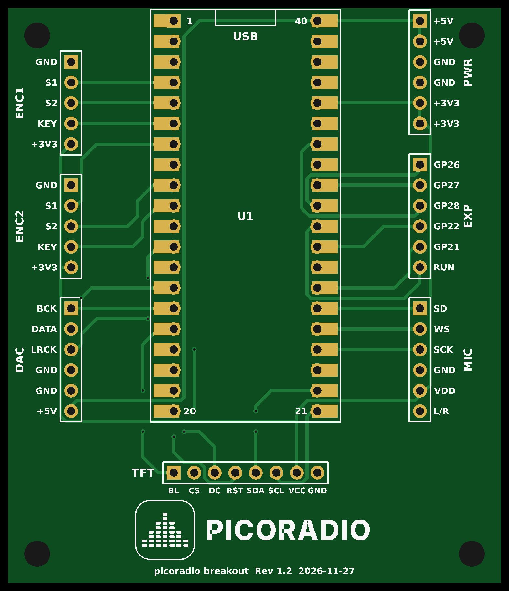

# picoradio breakout board (KiCad 8)

A carrier board for the Raspberry Pi Pico 2 W with a 2.54 mm goldpin header for every module of the radio.
The pin assignment is the firmware's (`include/config.h`), so no code changes are needed.

## Connectors

| Header | Pins (pin 1 first, square pad) | Notes |
|---|---|---|
| **J1 ENC1** | GND, S1 (GP2), S2 (GP3), KEY (GP4), +3V3 | encoder module order; + is 3V3, not 5 V |
| **J2 ENC2** | GND, S1 (GP5), S2 (GP6), KEY (GP7), +3V3 | |
| **J3 DAC** | BCK (GP11), DATA (GP10), LRCK (GP9), GND, GND, +5V | PCM5102 module order; VCC from USB 5 V |
| **J4 PWR** | +5V, +5V, GND, GND, +3V3, +3V3 | supply pins: +5V = Pico VBUS (USB), +3V3 = Pico 3V3(OUT), max ~300 mA |
| **J5 EXP** | GP26, GP27, GP28, GP22, GP21, RUN | spare GPIOs; RUN to GND resets the Pico |
| **J6 MIC** | SD (GP20), WS (GP19), SCK (GP18), GND, VDD (+3V3), L/R (GND) | INMP441 |
| **J7 TFT** | BL (GP12), CS (GP13), DC (GP14), RST (GP15), SDA (GP17), SCL (GP16), VCC (+3V3), GND | the ST7789 module's order reversed, for a straight cable |

Every pin is labelled on the silkscreen.

## Board

- **Size:** 61 × 71 mm, 2 layers, 1.6 mm, four M3 mounting holes.
- **Top layer:** all the signals, plus the picoradio logo and the pin labels on the silkscreen.
- **Bottom layer:** a solid **GND plane**. Every GND pin connects to it through thermal spokes, so it's easy to solder. A few signals dip to the bottom for a short hop where they must cross (36 mm in total).
- **Revision:** printed on the silkscreen from the title block, via the `${REVISION}` text variable (*File → Page Settings → Revision* in the PCB editor), so changing it there updates the board. Now Rev 1.2 (1.1: 45° tracks; 1.2: castellation pads, GND plane, logo on top).
- **Tracks:** 0.4 mm, 0.2 mm clearance, all bends at 45°, 0.6 / 0.3 mm vias. Fine for any hobby PCB service.
- **Pico, two ways:** every Pico pin has a through-hole *and* a surface-mount pad under the castellated edge.
  - **Socket** it on two 1x20 female headers (removable), or solder pin headers.
  - **Solder it flat**: align the castellations over the long pads and solder each one from the side. It's lower and needs no headers. Tracks under the Pico are covered by solder mask and the vias are tented, so the Pico's test pads underneath don't touch them; a layer of Kapton tape under the Pico adds margin.
  - Don't do both, because the holes would fill with solder.
- **All through-hole:** only goldpin headers, nothing small to solder.

## Ordering at JLCPCB

The ready Gerbers are in `gerbers/picoradio-breakout-rev1.2-gerbers-jlcpcb.zip`.

1. Go to jlcpcb.com → *Order now* and upload the zip. The viewer shows both sides; check the logo and labels.
2. Settings: **2 layers**, 1.6 mm, any colour, HASL (lead-free if you like). Leave the rest at the defaults.
3. No assembly is needed (all through-hole).

The zip holds: top/bottom copper (`.gtl/.gbl`), solder mask (`.gts/.gbs`), silkscreen (`.gto/.gbo`), outline (`.gm1`), plated and non-plated drill files (`.drl`). They were generated from the board data by `generator/gerbers.py` and checked by reading them back (`generator/gerber_check.py`):
- every hole sits in copper on both layers;
- the GND plane reaches all 17 GND pins as one area, with no floating copper;
- no other pin touches the plane;
- no silkscreen lies on a pad.

If you change the board in KiCad, export new Gerbers from KiCad instead: press **B** to fill the GND plane, then *File → Fabrication Outputs → Gerbers* (and *Drill Files*), and zip them.

## Files

| File | |
|---|---|
| `picoradio-breakout.kicad_pro` | open this in KiCad 8 |
| `picoradio-breakout.kicad_sch` | schematic |
| `picoradio-breakout.kicad_pcb` | routed PCB |
| `picoradio.kicad_sym`, `picoradio.pretty/` | project libraries: Pico 2 W symbol and footprint (holes + castellation pads), 1x08 row header |
| `gerbers/` | ready-to-order Gerber + drill zip for JLCPCB |
| `docs/` | previews of the board (rendered from the Gerbers) and the schematic |
| `generator/` | Python scripts that made the board (placement, router, checks) |

## Checks worth doing in KiCad

1. Open the project in KiCad 8 and press **B** in the PCB editor to fill the GND plane.
2. Run **Inspect → Design Rules Checker**. The board was checked with the generator's own clearance and connectivity checks, but not yet in KiCad itself.
3. Check the module pin orders against your modules (DAC, TFT, encoders, microphone). Clones differ. Swap the pins on the board or in the cable if yours differ.
4. Order with the ready zip (above), or export your own Gerbers after changes.

To regenerate after changing `generator/design.py` (pins, header positions): `python3 run_route.py && python3 chamfer.py && python3 write_kicad.py && python3 verify_files.py && python3 gerbers.py && python3 gerber_check.py` in `generator/` (needs Python 3 with matplotlib for the previews). The new files land in `generator/out/`; copy them over the ones here.
